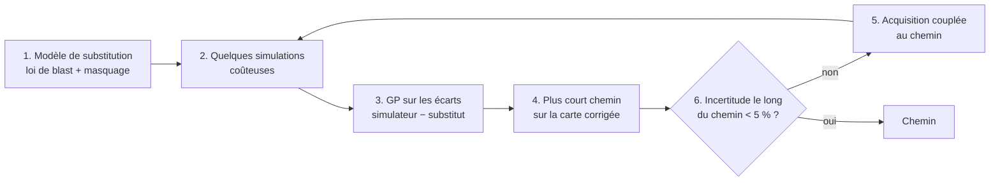

# Routage optimal sous contrainte d'exposition aux explosions

Projet réalisé en 2026 à CentraleSupélec, dans le cadre d'un partenariat avec CEA-DAM : trouver le trajet A → B qui minimise les dégâts cumulés en cas de détonation accidentelle. La méthode combine un modèle analytique, un processus gaussien qui apprend ses écarts, une recherche de chemin, et une boucle qui décide où lancer la prochaine simulation.

## ⚠️ Confidentialité

Ce projet a été réalisé sous accord de confidentialité avec CEA-DAM. **Une grande partie du code d'origine est confidentielle et n'est pas publiée ici** : le simulateur et ses intégrations, les scripts de calcul sur supercalculateur, les données de scène et de simulation, le traitement des maillages, et la partie 3D du pipeline. Seuls les éléments généraux, qui ne dépendent d'aucune donnée du projet, sont publiés.

Le rapport public décrit la méthode dans son ensemble.

## Principe de la méthode

Schéma repris de la démo de Tancrède Amiel (voir `demo/README.md`) :



Une version plus détaillée, avec les modules du pipeline, est dans le rapport public (figure 1).

## Contenu du dépôt

| Dossier | Contenu |
|---|---|
| [`pathfinding/dijkstra.py`](pathfinding/dijkstra.py) | Dijkstra sur graphe quelconque ou sur grille 8-connexe (avec ou sans coupe de coin) |
| [`pathfinding/delta_stepping.py`](pathfinding/delta_stepping.py) | Delta-Stepping séquentiel (Meyer & Sanders, 2003), avec calibration de Δ au 25e percentile |
| [`pathfinding/vtk_export.py`](pathfinding/vtk_export.py) | Export d'un chemin en VTK ASCII, lisible par ParaView, sans dépendance |
| [`visualization/plot_path.py`](visualization/plot_path.py) | Carte de coûts et chemin optimal, en PNG |
| [`tests/`](tests) | Tests unitaires ; Dijkstra et Delta-Stepping sont comparés à une référence |
| [`demo/`](demo/README.md) | Démo interactive de la méthode, dans le navigateur (JavaScript, sans dépendance) |
| [`docs/`](docs) | Rapport public du projet |

## Utilisation

```python
import numpy as np
from pathfinding.dijkstra import grid_graph, shortest_path
from pathfinding.delta_stepping import calibrate_delta, delta_stepping

cost = np.ones((50, 50))          # coût d'entrer dans chaque case
cost[10:40, 25] = np.inf          # case infranchissable (ex. un bâtiment)
adj = grid_graph(cost)

start, end = 0, 50 * 50 - 1       # case (i=0, j=0) et case (i=49, j=49)
total, path = shortest_path(adj, start, end)

delta = calibrate_delta([w for edges in adj.values() for _, w in edges])
total_ds, path_ds = delta_stepping(adj, start, end, delta)   # même coût que Dijkstra
```

## Tests

```bash
pip install -r requirements.txt
python3 -m unittest discover -s tests -v
```

Pour la démo : `cd demo && node --test tests/*.test.js` (Node ≥ 20).

## Démo

Le dossier `demo/` contient une démo interactive de la méthode complète, de la loi de substitution à la boucle d'acquisition. Elle remplace le simulateur confidentiel par un solveur acoustique 2D simple. Le README de la démo détaille les choix de modélisation et les limites.

La démo est une réécriture indépendante de **Tancrède Amiel**, à partir d'équations publiques. Elle est publiée sous licence MIT (`demo/LICENSE`). Elle n'est affiliée ni à CEA-DAM ni à CentraleSupélec.

## Licence

- `demo/` : MIT (© Tancrède Amiel).
- Le reste du dépôt : à compléter.
