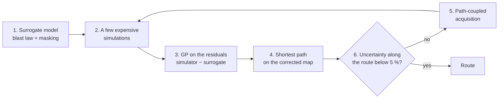

# Optimal Routing under Blast-Exposure Constraints

Project carried out in 2026 at CentraleSupélec, in partnership with CEA-DAM: find the route from A to B that minimises the cumulative damage caused by an accidental detonation along the way. The method combines an analytical surrogate, a Gaussian process that learns the surrogate's errors, a shortest-path search, and a loop that decides where to run the next expensive simulation.

## ⚠️ Confidentiality

This project was carried out under a confidentiality agreement with CEA-DAM. **Much of the original code is confidential and is not published here**: the simulator and its integration, the supercomputer job scripts, the scene and simulation data, the mesh processing, and the 3D part of the pipeline. Only general components that do not depend on any project data are published.

The public report describes the method as a whole.

## How the method works

Diagram adapted from the demo by Tancrède Amiel (see `demo/README.md`):



A more detailed version, with the pipeline modules, is in the public report (figure 1).

## Repository contents

| Folder | Contents |
|---|---|
| [`pathfinding/dijkstra.py`](pathfinding/dijkstra.py) | Dijkstra on a general graph or an 8-connected grid (with or without corner cutting) |
| [`pathfinding/delta_stepping.py`](pathfinding/delta_stepping.py) | Sequential Delta-Stepping (Meyer & Sanders, 2003), with Δ calibrated at the 25th percentile |
| [`pathfinding/vtk_export.py`](pathfinding/vtk_export.py) | Export of a path as ASCII VTK, readable in ParaView, no extra dependency |
| [`visualization/plot_path.py`](visualization/plot_path.py) | Cost map and optimal path, saved as PNG |
| [`tests/`](tests) | Unit tests; Dijkstra and Delta-Stepping are checked against a reference |
| [`demo/`](demo/README.md) | Interactive demo of the method, in the browser (JavaScript, no dependency) |
| [`docs/`](docs) | Public project report |

## Usage

```python
import numpy as np
from pathfinding.dijkstra import grid_graph, shortest_path
from pathfinding.delta_stepping import calibrate_delta, delta_stepping

cost = np.ones((50, 50))          # cost of entering each cell
cost[10:40, 25] = np.inf          # impassable cells (e.g. a building)
adj = grid_graph(cost)

start, end = 0, 50 * 50 - 1       # cell (i=0, j=0) and cell (i=49, j=49)
total, path = shortest_path(adj, start, end)

delta = calibrate_delta([w for edges in adj.values() for _, w in edges])
total_ds, path_ds = delta_stepping(adj, start, end, delta)   # same cost as Dijkstra
```

## Tests

```bash
pip install -r requirements.txt
python3 -m unittest discover -s tests -v
```

For the demo: `cd demo && node --test tests/*.test.js` (Node ≥ 20).

## Demo

The `demo/` folder contains an interactive demo of the full method, from the surrogate law to the acquisition loop. It replaces the confidential simulator with a simple 2D acoustic solver. The demo's README describes the modelling choices and limitations in detail.

The demo is an independent rewrite by **Tancrède Amiel**, based on public equations. It is released under the MIT licence (`demo/LICENSE`). It is not affiliated with CEA-DAM or CentraleSupélec.

## Licence

- `demo/`: MIT (© Tancrède Amiel).
- Rest of the repository: to be decided.
